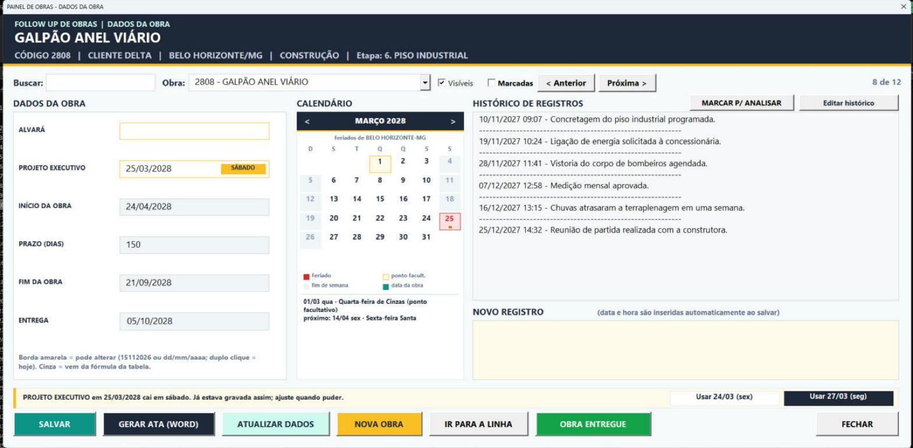
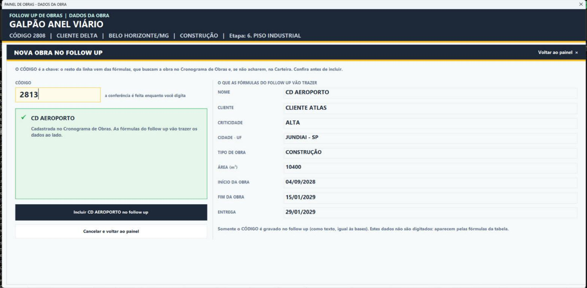
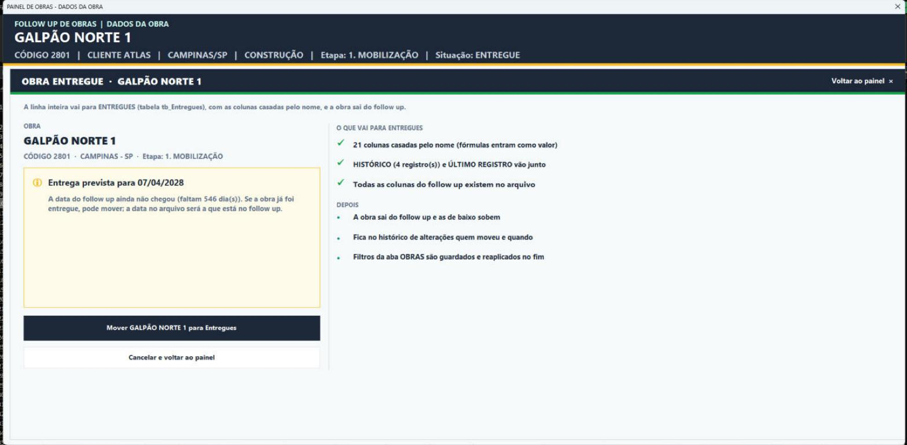

# Painel de Obras para Excel (VBA)

Painel em VBA para acompanhar o *follow up* de uma carteira de obras direto no Excel, sem desenhar nenhum formulário: todos os controles são criados por código e o projeto inteiro é instalado por um único módulo `.bas`.

A planilha de exemplo usa **obras fictícias de galpões logísticos** (clientes, códigos, endereços, datas e registros inventados).



## O que o painel faz

- **Ficha da obra**: dados vindos das bases (cliente, cidade, tipo, área, etapa, situação) e datas do cronograma, com edição das datas digitadas e bloqueio das que vêm de fórmula.
- **Histórico de registros**: nova observação com data e hora, histórico completo e coluna com o último registro.
- **Calendário com feriados**: feriados nacionais calculados (inclusive os móveis, a partir da Páscoa), estaduais e municipais numa aba `FERIADOS` editável; avisa quando uma data cai em fim de semana ou feriado.
- **Marcador "para analisar"**: marca a obra com o que precisa ser visto, data para revisar e quem pode ver; lista das obras marcadas.
- **Nova obra conferida na base**: digita-se só o CÓDIGO; o painel procura no cronograma e na carteira, mostra o que as fórmulas vão trazer e bloqueia códigos inexistentes ou duplicados.
- **Obra entregue**: move a linha inteira para a tabela de entregues (colunas casadas pelo nome) dentro do próprio painel, ou em lote por um botão na aba.
- **Ata no Word**: gera a ata da reunião com o último registro de cada obra da lista.
- **Log de alterações**: toda gravação feita pelo painel fica registrada em `tb_Alteracoes` (campo, antes, depois, usuário, data/hora).

### Nova obra conferida na base



### Obra entregue



## Estrutura do repositório

```
planilha/   Follow up Projetos 2028.xlsx   planilha de demonstração (tabelas do Excel)
instalador/ mInstaladorPainelObras.bas     instalador completo (é o único arquivo necessário)
src/        código-fonte de cada componente, para leitura e revisão
docs/img/   capturas de tela do painel
```

Os arquivos de `src/` são o mesmo código que o instalador grava no projeto VBA, separados por componente para facilitar a leitura. Os formulários (`*.frm.vba`) contêm só o código: os controles são criados em tempo de execução.

## Tabelas da planilha

| Aba | Tabela | Conteúdo |
|---|---|---|
| OBRAS | `tb_Obras` | Obras em andamento (base do painel). Só CÓDIGO, PROJETO BÁSICO, PROJETO EXECUTIVO, ALVARÁ, HISTÓRICO, ÚLTIMO REGISTRO e SITUAÇÃO são digitados; o resto é fórmula. |
| CRONOGRAMA | `tb_Cronograma` | Datas oficiais de início, fim e entrega. |
| CARTEIRA | `tb_Carteira` | Obras aprovadas, com área, criticidade e datas previstas. |
| ETAPAS | `tb_Etapas` | Etapa atual de cada obra. |
| CONTRATOS | `tb_Contratos` | Data de assinatura do contrato. |
| ENTREGUES | `tb_Entregues` | Obras que saíram do follow up por entrega. |
| CANCELADAS | `tb_Canceladas` | Obras canceladas. |
| ALTERAÇÕES | `tb_Alteracoes` | Log das alterações feitas pelo painel. |

O instalador cria também as abas `FERIADOS` (tabela `tb_Feriados`) e `MARCADORES` (oculta).

## Como instalar

1. Abra `planilha/Follow up Projetos 2028.xlsx` e salve como **Pasta de Trabalho Habilitada para Macro (.xlsm)**.
2. Em *Arquivo > Opções > Central de Confiabilidade > Configurações de Macro*, marque **Confiar no acesso ao modelo de objeto do projeto do VBA**.
3. No editor VBA (`Alt+F11`), use *Arquivo > Importar arquivo* e escolha `instalador/mInstaladorPainelObras.bas`.
4. Execute a macro `InstalarFollowUp` e salve a planilha.

Os botões **ABRIR PAINEL DE OBRAS** e **ARQUIVAR ENTREGUES** aparecem na aba OBRAS. O instalador pode ser executado de novo: substitui o código e mantém os dados (faz cópia do código anterior em `%TEMP%`).

Para usar com outra planilha, basta ter as tabelas acima com os mesmos nomes de tabela e de coluna (pelo menos `tb_Obras` e `tb_Alteracoes`).

## Casos para testar

| Código | O que testar |
|---|---|
| 2801 | Situação ENTREGUE: botão OBRA ENTREGUE no painel ou ARQUIVAR ENTREGUES na aba. |
| 2804 | Fim da obra num sábado: alerta no calendário. |
| 2806 | Fim da obra em 21/04 (Tiradentes). |
| 2812 | Fim da obra em 08/12 (feriado municipal de Campinas). |
| 2813 a 2815 | Só no cronograma: NOVA OBRA aparece em verde. |
| 2816 e 2817 | Só na carteira: NOVA OBRA aparece em amarelo. |
| 9999 | Não existe: NOVA OBRA fica bloqueada. |

## Requisitos

- Microsoft Excel para Windows (2010 ou superior, 32 ou 64 bits).
- Microsoft Word, apenas para gerar a ata.

## Licença

[MIT](LICENSE)
